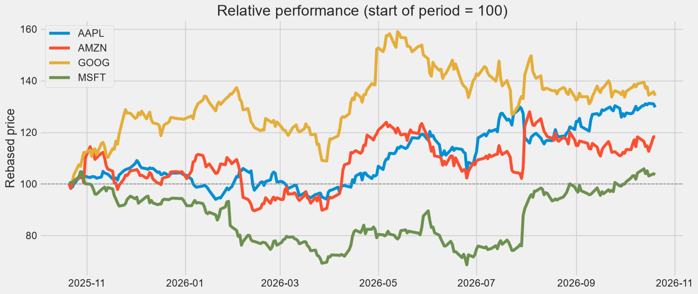
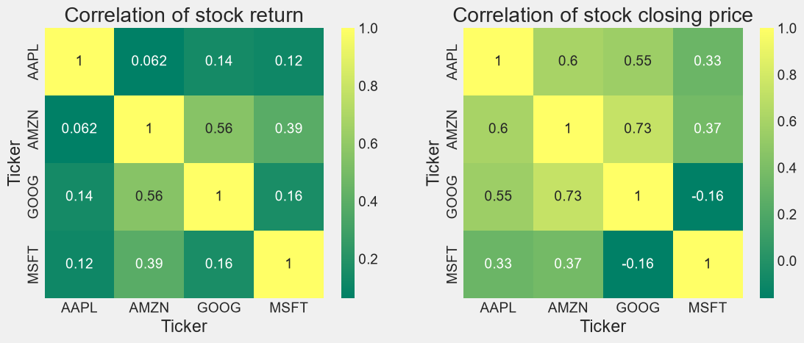
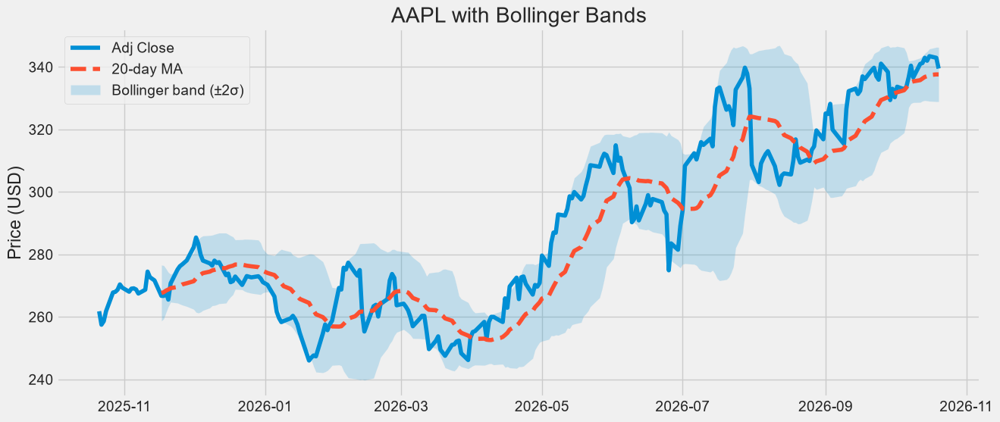
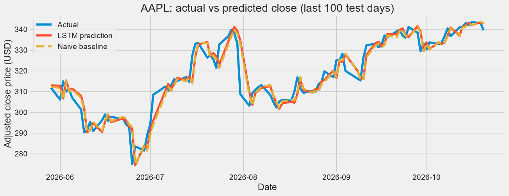

# Stock Market Analysis & LSTM Return Forecasting

End-to-end analysis of four large-cap tech stocks (**AAPL, GOOG, MSFT, AMZN**) using live Yahoo Finance data, followed by a **2-layer LSTM** that forecasts AAPL's next-day return and is benchmarked against two naive baselines.

**Stack:** Python 3.11 · pandas · NumPy · Matplotlib · Seaborn · scikit-learn · yfinance · TensorFlow/Keras

---

## Highlights

- **Live data pipeline:** pulls the last 12 months of OHLCV data for four stocks (and daily history since 2012 for modelling) directly from Yahoo Finance, so the analysis always reflects fresh data.
- **Technical analysis:** 10/20/50-day moving averages, Bollinger Bands, daily returns and their distributions, and 21-day rolling annualised volatility.
- **Cross-stock analysis:** return and price correlation heatmaps, pair plots, and a risk vs expected-return comparison.
- **Deep learning:** stacked LSTM (64 and 32 units) with dropout and early stopping, trained on 60-day windows of 5 features (return, volume change, 10/20-day MA gap, RSI).
- **Leakage-free setup:** chronological 95/5 train-test split, with scalers fitted on training data only.
- **Rigorous evaluation:** scored with RMSE, MAE, MAPE and directional accuracy against a "tomorrow = today" baseline and an "always up" baseline, instead of judging the model by a good-looking prediction chart.

## Screenshots

| Relative performance | Correlation heatmaps |
|---|---|
|  |  |

| AAPL Bollinger Bands | LSTM vs naive baseline |
|---|---|
|  |  |

## Key findings

| Insight | Result |
|---|---|
| Best 12-month performer | **GOOG +34.2%**, followed by AAPL +29.7%, AMZN +18.3%, MSFT +3.6% |
| Strongest return correlation | **AMZN-GOOG (0.56)**, then AMZN-MSFT (0.39) |
| Best diversifier | **AAPL**, with the lowest correlation to the others (0.06-0.14) |
| Best risk-adjusted profile | **AAPL**: lowest daily volatility with the second-highest expected return |
| Price vs return correlation | Price-level correlations are misleading for trending series (e.g. MSFT-GOOG is -0.16 on prices while the daily returns are positively correlated at 0.16), so returns are the reliable measure |

## LSTM forecasting: results

The model was evaluated on the held-out final 5% of AAPL's history (186 trading days, 26 Jan to 20 Oct 2026) and converted back to prices with `price_tomorrow = price_today × (1 + predicted_return)`.

| Model | RMSE | MAE | MAPE |
|-------|------|-----|------|
| **LSTM (return-based)** | **4.87** | **3.52** | **1.20%** |
| Naive baseline (previous close) | 4.92 | 3.58 | 1.22% |

| Directional accuracy | |
|---|---|
| LSTM | **57.5%** |
| "Always up" baseline | 54.8% |

The LSTM is marginally ahead of the naive baseline on every metric. The gap is small (about 1%) and comes from a single test period of 186 days, so it should be read as "on par with a very strong baseline" and not as a proven edge. The directional accuracy gap (57.5% vs 54.8%) is also within noise: with 186 test days the standard error is about 3.6 percentage points, so it is not statistically significant. The model also predicts very small daily moves (std 0.27% vs 1.66% actual), which is expected for next-day returns, where most of the movement is noise.

### How the model improved (v1 → v2)

| | v1: predict raw price | v2: predict next-day return |
|---|---|---|
| RMSE | 11.26 | 4.87 |
| MAPE | 3.14% | 1.20% |
| Directional accuracy | 47.8% | 57.5% |
| Mean price error | -5.97 USD (under-predicts) | -0.25 USD |
| vs naive baseline | worse (RMSE 4.95) | slightly better (RMSE 4.92) |

*v1 and v2 use slightly different test windows, so the comparison is approximate.*

**What I learned:**
- Predicting raw prices made the model fail on a rising stock: test prices went beyond the range seen in training, so it lagged and under-predicted by about 6 USD on average. Predicting returns removed this bias.
- Early stopping mattered: the training loss kept falling while the validation loss started rising after about 30 epochs, so training stopped at epoch 37 and the best weights (from epoch 29) were restored.
- Next-day returns contain very little learnable signal: the validation loss improved by only about 5% from its starting point.
- A "tomorrow = today" baseline is very hard to beat for daily prices, which is why the project reports baseline-relative metrics and not only a prediction plot.
- Directional accuracy needs a fair reference: AAPL went up on about 55% of test days, so a model must beat that, not just 50%.

## Roadmap

- [x] Predict next-day returns instead of raw prices
- [x] Add volume, moving-average and RSI features
- [x] Early stopping, dropout, scaler fitted on training data only
- [ ] Walk-forward validation across several periods, instead of a single split
- [ ] Add market-wide features (e.g. S&P 500) and tune window size and layers
- [ ] Compare against GRU and ARIMA, and test on the other three stocks

## Project structure

```
stock-market-lstm/
├── stock_market_lstm.ipynb   # full analysis + model, with outputs
├── lstm_model.keras          # trained model
├── requirements.txt          # pinned dependencies
├── images/                   # screenshots used in this README
└── README.md
```

## Getting started

```bash
git clone https://github.com/gupta-sanya/stock-market-lstm.git
cd stock-market-lstm
python -m venv venv
venv\Scripts\activate        # Windows  (use: source venv/bin/activate on macOS/Linux)
pip install -r requirements.txt
```

Open `stock_market_lstm.ipynb` in VS Code or Jupyter, select the `venv` kernel and run all cells. An internet connection is needed to download data. To model a different stock, change `TICKER` in section 6. Results vary slightly between runs and as new market data arrives.

## Disclaimer

Built for learning and portfolio purposes. It is not financial advice or a trading signal.
